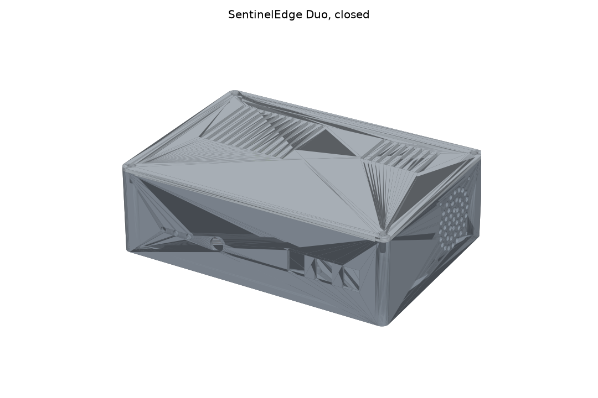
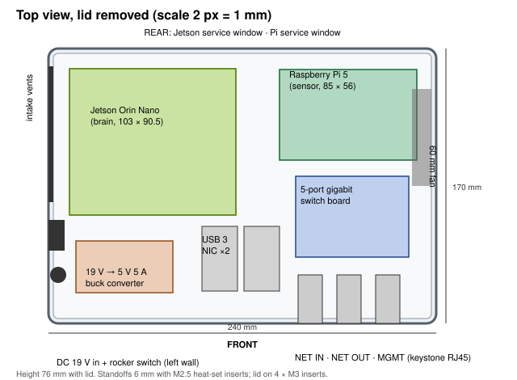
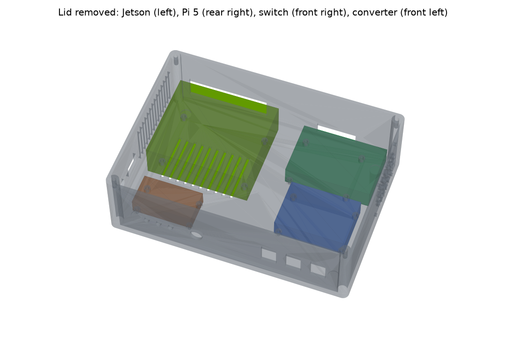
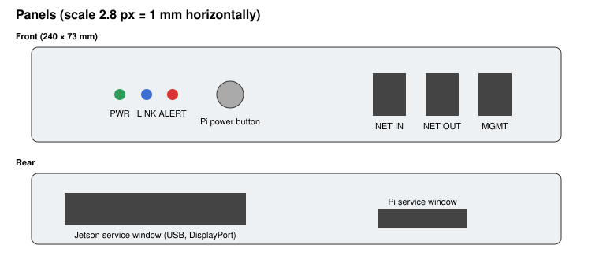
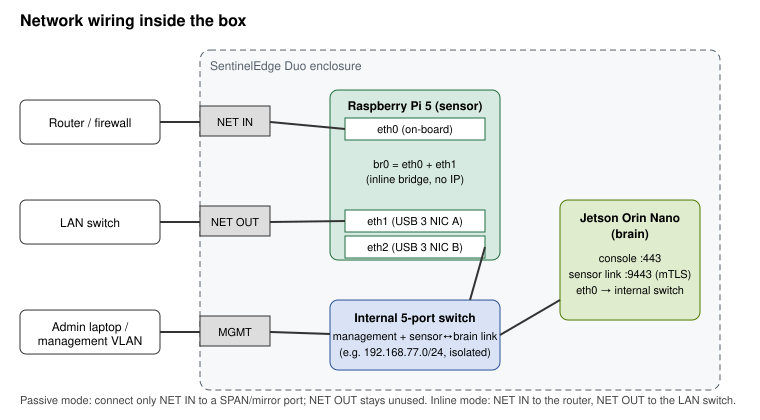
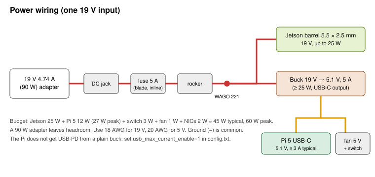

# SentinelEdge Duo: build guide

**SentinelEdge Duo** is one desktop box with a Raspberry Pi 5 as the **sensor** (it captures traffic, inline or from a mirror port) and a Jetson Orin Nano as the **brain** (it runs the console, stores the data, scores the flows and sends commands). They talk over an internal switch using the existing mutual-TLS sensor ↔ brain link. One 19 V adapter powers the whole box.



| File | What it is |
|---|---|
| `cad/duo_enclosure.py` | The parametric 3D model. Every dimension is a constant at the top of the file. |
| `stl/duo_base.stl`, `stl/duo_lid.stl` | The parts you print |
| `stl/duo_assembly.stl` | The base, the lid and the boards together, for checking fit. Do not print it. |
| `viewer.html` | Interactive 3D view: open it in a browser, rotate it, and turn each part on or off |
| `renders/*.png`, `diagrams/*.svg` | The pictures in this guide |

Outside size: **240 × 170 × 76 mm**. Print volume: 287 cm³ for the base and 116 cm³ for the lid, about 0.5 kg of filament.

---

## 1. Layout





- The **Jetson** sits on the left with its I/O edge toward the rear service window. Its own fan blows up through the lid vents.
- The **Pi 5** with its active cooler sits at the rear right, just in front of the 60 mm exhaust fan on the right wall.
- The **switch board** sits at the front right, 38 mm behind the front wall, because the keystone jacks reach about 30 mm into the box.
- The **buck converter** sits at the front left, near the DC inlet on the left wall.
- **Air path:** in through the left-wall slots and the floor vents under the Jetson, then out through the right-wall fan and the lid slots.



## 2. Network



| Port | Connects to | Used for |
|---|---|---|
| **NET IN** | Pi `eth0` (on-board) | **Inline:** the router side. **Passive:** a switch SPAN/mirror port. |
| **NET OUT** | Pi `eth1` (USB 3 NIC A) | **Inline:** the LAN switch side. **Passive:** not used. |
| **MGMT** | internal switch | Your admin network: the console on the Jetson and SSH to both boards |
| *(internal)* | Pi `eth2` (USB 3 NIC B) ↔ switch ↔ Jetson `eth0` | Sensor ↔ brain link (TCP 9443, mutual TLS) |

The capture ports never have an IP address. The Pi is managed only through `eth2`.

## 3. Power



Everything runs from one **19 V, 90 W** barrel adapter. The adapter must be safety-certified (CE/UL); then everything inside the box runs at low voltage.

**Power budget:**

| Part | Typical | Peak |
|---|---|---|
| Jetson | — | 25 W (Super mode) |
| Pi 5 | 12 W | 27 W |
| Switch | 3 W | |
| Fan | 1 W | |
| USB NICs | 2 W | |
| **Whole box** | **≈ 45 W** | **≈ 60 W** |

---

## Bill of materials

Prices are rough single-unit retail prices in USD (late 2026). Check your local suppliers.

| # | Part | Qty | ≈ USD |
|---|---|---|---|
| 1 | Raspberry Pi 5, 8 GB, with official Active Cooler | 1 | 85 |
| 2 | NVIDIA Jetson Orin Nano Super Developer Kit (8 GB) | 1 | 249 |
| 3 | NVMe SSD 256 GB (Jetson) + microSD 64 GB A2 or NVMe HAT (Pi) | 1 + 1 | 45 |
| 4 | USB 3 gigabit Ethernet adapter (RTL8153 or AX88179) | 2 | 30 |
| 5 | 5-port gigabit switch board, about 70 × 50 mm, 5 V (or a small 5-port switch with its case removed) | 1 | 15 |
| 6 | DC-DC buck converter, 8–24 V in, 5.1 V 5 A out, USB-C output or pigtail | 1 | 12 |
| 7 | 19 V 4.74 A (90 W) adapter, 5.5 × 2.5 mm plug | 1 | 25 |
| 8 | Panel-mount DC jack 5.5 × 2.5 mm (11 mm hole), rocker switch (19 × 13 mm), inline blade fuse holder + 5 A fuse | 1 each | 8 |
| 9 | Keystone RJ45 Cat6 couplers | 3 | 9 |
| 10 | Cat6 patch cables, 15 cm, slim | 5 | 10 |
| 11 | 60 mm 5 V fan (e.g. Noctua NF-A6x25 5V) with grille | 1 | 16 |
| 12 | 5 mm LED holders + LEDs (green, blue, red) + 330 Ω resistors; 12 mm momentary push button | 1 set | 6 |
| 13 | Heat-set inserts: M2.5 × 16, M3 × 4; M2.5 × 6 screws, M3 × 8 countersunk screws; 4 rubber feet (10 mm) | 1 set | 10 |
| 14 | Wire: 18 AWG red/black (19 V), 20 AWG (5 V), WAGO 221 connectors, heat-shrink, velcro strips | — | 8 |
| 15 | PETG or ASA filament | 0.5 kg | 12 |
| | **Total parts** | | **≈ 540** |

**Tools:**
- 3D printer with at least a 250 × 180 mm bed
- Soldering iron with a heat-set insert tip
- Calipers, crimp tool, multimeter
- Hex drivers
- A PC to flash the storage

---

## Step by step

### Step 1: Measure your boards and generate the model

1. With calipers, measure the mounting-hole centres of **your** Jetson carrier board and of the switch and buck boards. The model uses:
   - **Pi 5:** 58 × 49 mm holes, 3.5 mm from the edge. This is the official pattern.
   - **Jetson carrier:** 86 × 58 mm. This is the Jetson Nano-family pattern. **Check it.** Carrier revisions differ.
   - **Switch** and **buck** boards: placeholders. Generic boards vary.
2. Edit the `holes=` and `size=` values at the top of `cad/duo_enclosure.py`.
3. Generate the files:

   ```bash
   python3 -m venv ~/cad && ~/cad/bin/pip install manifold3d numpy matplotlib
   cd hardware/sentineledge-duo/cad && ~/cad/bin/python duo_enclosure.py
   ```

   This rewrites `stl/`, `renders/` and `viewer.html`.
4. Open `viewer.html` and look for collisions. Check especially:
   - the keystone jacks against the switch board
   - cable room above the Pi
   - the Jetson heatsink against the lid

### Step 2: Print

| Setting | Base | Lid |
|---|---|---|
| Material | PETG (or ASA if the box will sit somewhere warm) | same |
| Orientation | open side up | flat face on the bed (the STL is already flipped) |
| Layer / walls / infill | 0.2 mm, 4 walls, 20 % gyroid | 0.2 mm, 4 walls, 20 % |
| Supports | only under the top edge of the 82 mm rear Jetson window ("support on build plate only") | none |
| Time on a fast printer | about 9 h | about 2 h |

If your bed is smaller than 250 mm, reduce `OUTER` only if the boards still fit. Otherwise, cut the base in two in your slicer and join it with a printed dovetail and glue.

### Step 3: Heat-set inserts

1. Press **M2.5 inserts** into the 16 standoffs: Pi ×4, Jetson ×4, switch ×4, buck ×4.
2. Press **M3 inserts** into the 4 corner bosses for the lid.
3. Set the iron to about 220 °C for PETG. Push the insert in straight and let it sink in under its own weight.

### Step 4: Panel hardware

1. **Front panel:**
   1. Clip in the 3 keystone couplers, labelled from left to right: NET IN, NET OUT, MGMT.
   2. Fit the 3 LED holders: PWR green, LINK blue, ALERT red.
   3. Fit the 12 mm push button.
2. **Left wall:** screw in the DC jack and snap in the rocker switch.
3. **Right wall:** mount the 60 mm fan **blowing outwards** (the arrow on the frame points out). Use 4 × M3 screws and nuts, with the grille on the outside.
4. Stick the rubber feet into the floor recesses.

### Step 5: Power wiring

1. **19 V side:** wire DC jack (+) → fuse → rocker → a WAGO 221. Use 18 AWG wire.
2. From the WAGO:
   - one lead goes to a **5.5 × 2.5 mm barrel pigtail** for the Jetson
   - one lead goes to the **buck converter input**
3. Connect all grounds (−) together.
4. Before you connect any board, power up and measure the buck output with the multimeter. Set it to **5.10 V**.
5. **5 V side:**
   - Connect the buck's USB-C output to the Pi 5. If your buck has a pigtail, use a USB-C power cable rated for 5 A.
   - Run a second 5 V lead to the fan and to the switch board (check the switch board's own input voltage).
6. Mount the buck on its standoffs. Fix every wire run with velcro or zip ties so nothing can touch the fans.

### Step 6: Mount the boards

1. **Jetson:**
   1. Install the NVMe SSD on the carrier first.
   2. Screw the carrier onto its four standoffs (M2.5 × 6).
2. **Pi 5:**
   1. Fit the Active Cooler.
   2. Fit the microSD card or the NVMe HAT.
   3. Screw the Pi onto its standoffs.
3. **Switch board:** screw it onto its standoffs.
4. **USB NICs:** fix both to the floor with velcro, between the buck and the switch. Plug them into the Pi's **blue USB 3** ports.

### Step 7: Network cabling

Use the 15 cm patch cables.

| From | To |
|---|---|
| NET IN coupler | Pi on-board Ethernet (`eth0`) |
| NET OUT coupler | USB NIC A (`eth1`) |
| MGMT coupler | switch port 1 |
| USB NIC B (`eth2`) | switch port 2 |
| Jetson Ethernet | switch port 3 |

Label every cable at both ends.

### Step 8: Button and LEDs

1. **Power button:** wire the 12 mm button to the Pi 5's **J2 power-button pads** (solder two thin wires). It works like the board's own button: press to start, press twice for a clean shutdown.
2. **PWR LED:** connect it to the 5 V rail through a 330 Ω resistor. It is lit while the box has power.
3. **LINK and ALERT LEDs:** connect them to Pi GPIO 17 and GPIO 27, each with a 330 Ω resistor to GND. *The software does not drive these yet.* They are reserved for a small LED service (LINK = brain reachable, ALERT = unacknowledged high alert). Until that exists, leave them unconnected or drive them yourself with `gpioset`.

### Step 9: Install the software

1. **Jetson (brain):**
   1. Flash JetPack to the NVMe SSD with the NVIDIA SDK Manager, or use the SD-card image with the NVMe as root.
   2. Run the brain installer:

      ```bash
      sudo deploy/jetson/install_brain.sh        # private Python 3.11, offline wheels
      ```

   3. Open `https://<jetson-ip>` from the MGMT network, complete the setup wizard and choose **Brain**.
   4. Create a one-time enrolment code:

      ```bash
      sudo -u sentinel .venv/bin/python -m brain code --brain-url https://<jetson-internal-ip>:9443
      ```

2. **Pi 5 (sensor):**
   1. Flash Raspberry Pi OS Lite 64-bit.
   2. Add this line to `/boot/firmware/config.txt`. The buck does not negotiate USB-PD, so without it the Pi limits its USB current:

      ```
      usb_max_current_enable=1
      ```

   3. Install with `scripts/install.sh`.
   4. In the setup wizard choose **Sensor**. For placement, choose **passive** (mirror port on NET IN) or **inline**: a bridge of `eth0` + `eth1`, see `updates.md`.
   5. Run the `python -m sensor enroll …` command that the brain printed.
3. **Both boards:** run the OS hardening script, then check that the sensor shows up as **online** in the console under **Operations → Sensors**:

   ```bash
   sudo deploy/pi/harden_os.sh --apply
   ```

### Step 10: Burn-in and acceptance test

Do this before you ship any unit.

| Test | Pass when |
|---|---|
| 30 min `stress-ng --cpu 4` on both boards with the lid closed | Pi < 75 °C, Jetson < 80 °C, no throttling (`vcgencmd get_throttled` = `0x0`) |
| Unplug and replug the brain link cable | the sensor buffers, then replays; no flow lost |
| Inline: 1 Gb/s `iperf3` through NET IN → NET OUT for 1 h | no drops in the capture-overload metric |
| Inline: pull the power | **the network goes down**: see "fail-open" below; this is expected without a bypass |
| Reboot | both services come back; console reachable on MGMT |

Fill in a label with the serial number, both MAC addresses and the brain CA fingerprint, and stick it on the floor of the box.

---

## Turning it into a product you can sell

The box above is a solid **prototype and pilot-site unit**. Before you sell it in volume, settle these points:

1. **Development kits are not production parts.**
   - The Jetson Orin Nano *Developer Kit* is sold for development. For a product, use the **Jetson Orin Nano production module** on a commercial carrier board (Seeed, Auvidea, Connect Tech and others), which comes with a lifecycle and a warranty.
   - On the Pi side, the **Compute Module 5** on a carrier with two native gigabit ports removes the USB NICs.
   - Both changes alter the mounting holes. Edit the constants in the model and regenerate.
2. **Fail-open for inline use.**
   - Without power, an inline box cuts the network. The software watchdog only covers the case where the software fails.
   - Sell inline units with a **bypass**: a relay bypass board, or a bypass NIC that connects NET IN to NET OUT when power or the heartbeat is lost.
   - Otherwise, sell the box for **passive (mirror-port) mode only** and say so in the datasheet.
3. **Certification.**
   - Each board's own certification does **not** cover the finished product. The assembled box needs **EMC testing for CE (EN 55032/55035) and FCC Part 15B**.
   - A certified external adapter keeps it a low-voltage product, which avoids most safety testing.
   - A plastic case radiates more. Conductive paint inside the case, or a folded aluminium case, makes passing EMC easier.
   - IEC 62443-4-2 (PLAN.md, Phase 11) comes later.
4. **Names and logos.**
   - Do not put "Raspberry Pi" or "NVIDIA/Jetson" in the product name.
   - Use the vendors' partner programmes ("Powered by Raspberry Pi", the NVIDIA Partner Network) if you want to mention them.
5. **Manufacturing.**
   - 3D printing is right for up to roughly 50–100 units.
   - Beyond that, quote a **folded and powder-coated aluminium** case, which also helps with heat and EMC, or injection moulding. Moulding tooling costs several thousand USD, so it only pays at volume.
   - The CAD constants document every cut-out a manufacturer needs.
6. **Each unit you ship should have:**
   - a serial number
   - a burn-in record (step 10)
   - a pinned software version (`sentinelctl status`)
   - the release SBOM
   - a quick-start card: which port goes where, and the console URL
7. **Price guide.**
   - Parts cost about $540 at single quantity, and about $380–420 at 100 units with production modules.
   - Assembly and burn-in take about 1.5 h.
   - Appliances in this class usually sell for 2.5–3× parts cost, plus a yearly software and support subscription.

## Limits of this design

- **Throughput:**
  - The Pi sensor handles about 120k packets/s, roughly 0.5–1 Gb/s of typical traffic (docs/PERFORMANCE.md).
  - The USB NICs are gigabit.
  - For more than that, use the x86 sensor planned in Phase 11.
- **Ventilation:** the box is designed for a desk or a shelf with free air around it, at no more than about 35 °C. It is not sealed against dust or water.
- **Fit:** the dimensions come from published data, and the model has not yet been printed and test-fitted. Print the base, then check the hole positions before you print a batch.
